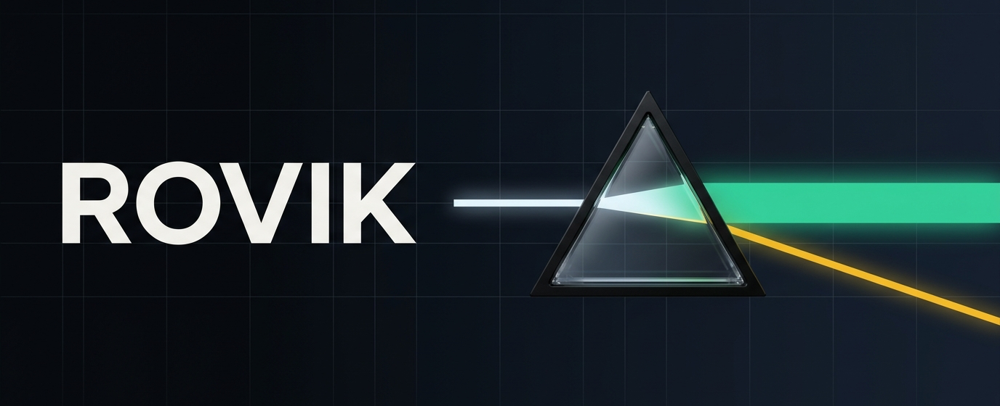
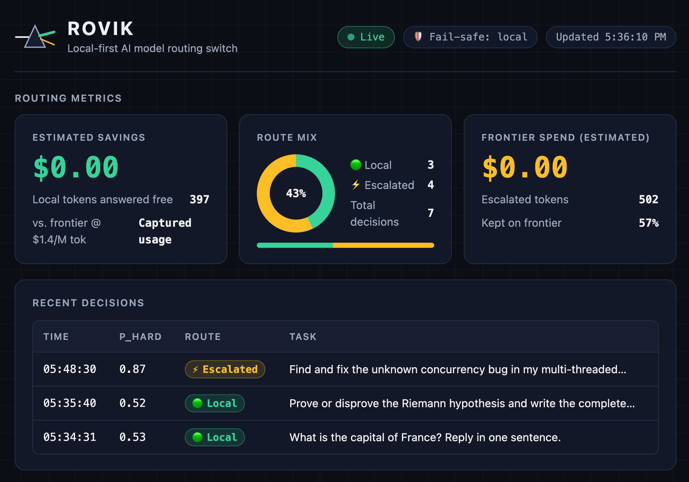

# Rovik



**Send easy prompts to your free local model, escalate hard ones to a frontier API, and track what you saved.**

Rovik puts an OpenAI-compatible routing switch in front of your AI apps or agent harness. A tiny ~400M classifier (**Laya**) reads each prompt on your own hardware in ~40ms, routes routine work to your local LLM, and passes genuinely demanding work to your chosen frontier model.

> **Status:** Experimental (`v0.2`) on Apple Silicon (macOS). The same routing architecture has run daily behind a local-first Hermes agent profile on single-turn completions, streaming SSE, and tool-carrying OpenAI Chat Completions payloads (`/v1/chat/completions` — simple tool calls stay local; hard multi-step chains escalate); this repo is its cleaned-up continuation, verified end-to-end from a clean clone but not yet soak-tested on live traffic. Harnesses speaking Anthropic Messages (`/v1/messages`, e.g. Claude Code) or OpenAI Responses (`/v1/responses`, e.g. current Codex CLI) are not natively supported yet (see [§2](#2-run-it-in-your-agent) & [DESIGN.md §5](DESIGN.md#5-status-open-problems--troubleshooting)).
> **Looking for the methodology, benchmarks, and why Rovik works this way?** Read [DESIGN.md](DESIGN.md).

```text
  Your App / Agent
         │  (base_url = http://127.0.0.1:8788/v1)
         ▼
  ┌─────────────────────────────┐       consults (~40ms)      ┌───────────────────────────┐
  │  Rovik Proxy (:8788)        │ ──────────────────────────► │  Laya Sidecar (:8777)     │
  └──────┬───────────────┬──────┘                             └───────────────────────────┘
         │               │
  p_hard < cutoff  p_hard >= cutoff
         ▼               ▼
  [🟢 LOCAL]       [⚡ ESCALATED]
  Your Local LLM   Frontier API
  (free, private)  (OpenRouter / OpenAI / custom)
```



*Live dashboard served directly by the proxy at `/` (zero-config, no separate server) — showing both paths in one frame: a famous-but-simple prompt (Riemann, `p_hard 0.52` → local) and a hard multi-step debugging task (`p_hard 0.87` → escalated).*

---

## Contents

- [The Three Model Roles](#the-three-model-roles)
- [1. Quick Start (5 minutes)](#1-quick-start-5-minutes)
- [2. Run It in Your Agent](#2-run-it-in-your-agent)
- [3. Bring Your Own Data (Training on Your Prompts)](#3-bring-your-own-data-training-on-your-prompts)
- [4. Reference Local Model Setups](#4-reference-local-model-setups)
- [5. Configuration, Privacy & Fail-Safe](#5-configuration-privacy--fail-safe)
- [6. Results & Design Deep-Dive](#6-results--design-deep-dive)
- [7. CLI Reference, Project Layout & Tests](#7-cli-reference-project-layout--tests)

---

## The Three Model Roles

Rovik separates three distinct jobs so smaller local hardware works well too:

1. **Local Model (Tier 1 — live answering):** Answers routine prompts for free on your hardware. Can be any size that fits your machine (7B, 14B, 35B, etc.)—smaller models simply use a lower `LAYA_THRESH_HARD` cutoff (for example `0.5`–`0.6` instead of `0.8`) so Rovik escalates sooner.
2. **Frontier Model (Tier 2 — escalation):** Answers prompts flagged as hard, or handles fallback if your local model errors out (OpenRouter, OpenAI, or any OpenAI-compatible endpoint).
3. **Labeling Teacher (training-time only):** Labels your historical prompt corpus once so Laya learns *your* workload. Use a ≥30B local model or point temporarily at your frontier API (labeling 500–1,000 short prompts costs very little).

---

## 1. Quick Start (5 minutes)

### Install

```bash
git clone https://github.com/rushter777/rovik.git
cd rovik

python3.11 -m venv .venv
source .venv/bin/activate

# Apple Silicon (serving + MLX sidecar + Laya runtime + PyTorch training):
pip install -e ".[mlx,train]"

# Or from the pinned requirements list:
# pip install -r requirements.txt
```

*(Note: `.[mlx]` and `requirements.txt` include `laya-mlx` and pin `huggingface-hub>=1.31.0,<2`, verified compatible with `transformers` and training downloads. `python3 -m rovik <command>` also works from the repo root without an editable install.)*

### Configure once (`rovik init`)

```bash
rovik init
```

The wizard prompts for your local model server (llama.cpp, Ollama, LM Studio, vLLM/MLX-LM, or custom), your frontier provider/model/price, your labeling teacher, your corpus/checkpoint paths, and your preferred agent harness. It writes a gitignored `rovik.env` (`0600` permissions, without storing raw API keys), runs dependency/checkpoint preflight checks, and prints your exact parameterized copy-paste harness config. Inspect resolved settings anytime (with secrets redacted and env overrides flagged) via:

```bash
rovik config
```

### Optional: 1-minute toy smoke run

If you don't have a trained Laya checkpoint yet, test the pipeline end-to-end on the 40-row synthetic toy dataset:

```bash
python3 data/synthetic/generate.py
rovik train --data data/synthetic/synthetic_corpus.jsonl --output-dir checkpoints/cold-test --epochs 2
rovik eval --checkpoint checkpoints/cold-test --data data/synthetic/synthetic_corpus.jsonl --output eval/cold_metrics.json
```

*(Already trained a Laya checkpoint earlier? Just point `LAYA_MODEL_PATH` in `rovik.env` at it—no retraining required.)*

### Start, wire, verify

Ensure your local LLM server is running, then follow the full lifecycle (`rovik init` → `rovik start` → `rovik harness <tool>` → point your harness at the proxy → `rovik status`):

```bash
# 1. Launch Laya sidecar (:8777) and Rovik proxy (:8788) in the background (logs in ROVIK_LOG_DIR)
rovik start

# 2. Print the copy-paste config for your harness (parameterized from rovik.env)
rovik harness hermes    # or: opencode | aider | continue | generic | all
```

Paste the printed snippet into your agent harness so it sends OpenAI Chat Completions (`/v1/chat/completions`) to `http://127.0.0.1:8788/v1` (see [§2 Run It in Your Agent](#2-run-it-in-your-agent) for per-tool details).

```bash
# 3. Verify health, key-source diagnostics, and any startup calibration warnings
rovik status

# Optional: test one judgment directly or open the live savings dashboard
rovik judge "Find why the CI tests keep failing and fix the root cause"
open http://127.0.0.1:8788/

# Stop both background processes anytime
rovik stop
```

*(Need foreground terminal logs during debugging? `rovik sidecar` and `rovik proxy` still run individually in separate terminals.)*

---

## 2. Run It in Your Agent

Rovik exposes `POST /v1/chat/completions` and `GET /v1/models` on `http://127.0.0.1:8788/v1` (supporting streaming SSE and tool-carrying payloads: simple tool calls stay local; hard multi-step chains escalate).

**Generate parameterized snippets from your `rovik.env` anytime:** `rovik init` prints the copy-paste config for your chosen harness at the end of setup using your real `ROVIK_PROXY_PORT`, `ROVIK_LOCAL_MODEL`, and reply tags; to print one later run:

```bash
rovik harness hermes    # or: opencode | aider | continue | generic | all
```

### Generic recipe (`/v1/chat/completions`)

- **`base_url`:** `http://127.0.0.1:8788/v1`
- **`model`:** Any placeholder string (for example `rovik-proxy` or your local model's name) — the proxy overwrites the incoming `model` field per tier with `ROVIK_LOCAL_MODEL` or `ROVIK_ESC_MODEL`.
- **`api_key`:** Any dummy string (for example `no-key-needed`) — the proxy is loopback-only; the frontier key (`ROVIK_ESC_KEYNAME`, default `OPENROUTER_API_KEY`) is read by the proxy process from its own environment or `ROVIK_ENV_FILE`, never from the client.

> **Verification scope:** The same routing architecture has run daily behind a local-first Hermes agent profile; this repo is its cleaned-up continuation, verified end-to-end from a clean clone (including generic OpenAI SDK calls) but not yet soak-tested on live traffic. The OpenCode, Aider, and Continue examples below follow each tool's documented `/v1/chat/completions` configuration syntax.

### Hermes

The same routing architecture has run daily behind a local-first Hermes agent profile; the model block below is the profile configuration used with it and works for any Hermes profile pointing at this proxy:

```yaml
# ~/.hermes/profiles/<your-agent-profile>/config.yaml
model:
  default: Qwen3.6-35B-A3B-UD-Q4_K_XL   # any placeholder — proxy overwrites with ROVIK_LOCAL_MODEL / ROVIK_ESC_MODEL
  provider: custom
  base_url: http://127.0.0.1:8788/v1     # the Rovik proxy
  api_key: no-key-needed                 # loopback, no auth on the proxy
  context_length: 65536
  request_timeout_seconds: 300
```

- **Model name is a placeholder by design:** The proxy replaces `model` per tier before forwarding upstream, so clients can send `rovik-proxy`, a local model name, or anything else.
- **No API key at the proxy:** Loopback-only with no client auth; your frontier key stays isolated in the proxy's environment / `ROVIK_ENV_FILE`.
- **Streaming works end-to-end:** Streaming SSE chunks pass through directly, with the route tag prepended to the first content-bearing chunk.

### OpenCode (`~/.config/opencode/opencode.json` or project `opencode.json`)

```json
{
  "$schema": "https://opencode.ai/config.json",
  "provider": {
    "rovik": {
      "npm": "@ai-sdk/openai-compatible",
      "name": "Rovik Router",
      "options": {
        "baseURL": "http://127.0.0.1:8788/v1",
        "apiKey": "no-key-needed"
      },
      "models": {
        "rovik-proxy": {
          "name": "Rovik Router"
        }
      }
    }
  },
  "model": "rovik/rovik-proxy"
}
```

### Aider

```bash
export OPENAI_API_BASE="http://127.0.0.1:8788/v1"
export OPENAI_API_KEY="no-key-needed"
aider --model openai/rovik-proxy
```

### Continue (`~/.continue/config.yaml`)

```yaml
name: Rovik Local Router
version: 1.0.0
schema: v1

models:
  - name: Rovik Router
    provider: openai
    model: rovik-proxy
    apiBase: http://127.0.0.1:8788/v1
    apiKey: no-key-needed
    roles:
      - chat
      - edit
      - apply
```

### Harnesses Not Supported Natively Yet (Protocol Gaps)

- **Claude Code (`/v1/messages`):** Speaks Anthropic Messages (`ANTHROPIC_BASE_URL` → `/v1/messages`) exclusively. Needs an Anthropic→OpenAI translation adapter (such as LiteLLM or `claude-code-proxy`) in front of Rovik, or a `/v1/messages` route in Rovik.
- **Codex CLI (`/v1/responses`):** Current Codex CLI removed `wire_api = "chat"` and requires the OpenAI Responses API (`wire_api = "responses"` → `/v1/responses`). Needs a Responses→Chat-Completions adapter, or a `/v1/responses` route in Rovik.

See [DESIGN.md §5](DESIGN.md#5-status-open-problems--troubleshooting) for tracked protocol gaps and harness edge cases.

---

## 3. Bring Your Own Data (Training on Your Prompts)

Rovik's core finding is that generic classifier leaderboards don't transfer to your tasks—fine-tuning Laya on **your own prompts** is where the accuracy comes from.

### Where does your corpus come from?

- **Already have prompt history?** `rovik prepare-data` reads:
  - Plain `.txt` (one prompt per line)
  - `.csv` (auto-detects `state`, `task_text`, `task`, `prompt`, `query`, `text`, `message`, or pass `--column <name>`)
  - `.jsonl` or `.json` (lists of strings/dicts, OpenAI `messages` logs, or Rovik's own `data/proxy_log.jsonl` / `data/shadow_log.jsonl`)
- **Starting from scratch?** Run Rovik for a few days first. Every request automatically appends your real prompts to `data/proxy_log.jsonl`, which you can feed straight back into `rovik prepare-data`.

### Step-by-step: from raw prompts to a tuned router

1. **Inspect your file first (zero API calls):**
   ```bash
   rovik prepare-data --input path/to/your_prompts.jsonl --inspect
   ```
   Shows detected format, duplicates removed, short rows skipped, and a 3-row preview.

2. **Run the teacher self-agreement check & label all 5 heads:**
   ```bash
   rovik prepare-data \
     --input path/to/your_prompts.jsonl \
     --check-agreement 100 \
     --strict-gate
   ```
   This samples 100 prompts twice (`temperature=0.7`) to confirm ≥85% teacher consistency (`data/agreement_report.json`), labels all 5 Laya heads with full prompt text preserved (`tools_file`, `tools_terminal`, `tools_web`, `needs_verification`, and 0–4 `difficulty`), checkpoints progress into `data/labeled_corpus.jsonl` so interrupted runs resume cleanly, and writes deterministic `data/train.jsonl` + `data/eval.jsonl` splits.

   *(Using a frontier API as teacher temporarily? Set `ROVIK_TEACHER_URL`, `ROVIK_TEACHER_MODEL`, and `ROVIK_TEACHER_KEYNAME` in `rovik.env` or pass `--teacher-url` / `--teacher-model` / `--teacher-keyname`.)*

3. **Train and evaluate on your held-out split:**
   ```bash
   rovik train --data data/train.jsonl --output-dir checkpoints/laya-ft
   rovik eval --checkpoint checkpoints/laya-ft --data data/eval.jsonl
   ```

4. **Calibrate your escalation cutoff for your local model:**
   ```bash
   rovik sweep checkpoints/laya-ft data/eval.jsonl
   ```
   Pick the `LAYA_THRESH_HARD` cutoff from the precision/coverage table (e.g., `0.8` for a 35B MoE local tier, or `0.5`–`0.6` for a smaller 7B–14B local model), set it in `rovik.env`, and set `LAYA_MODEL_PATH=checkpoints/laya-ft`.

5. **Close the loop asynchronously (optional):** Extract deterministic runtime signals (`tool_error`, `user_retry`, `explicit_success`) from agent transcripts and enrich your shadow ledger offline:
   ```bash
   rovik outcomes extract path/to/transcript.log
   rovik outcomes join
   ```

---

## 4. Reference Local Model Setups

### Apple Silicon Reference (`llama.cpp` + Qwen3.6-35B-A3B)

This is the author's reference setup on Apple Silicon (`M1`, `64GB` unified memory), serving **Qwen3.6-35B-A3B** (`UD-Q4_K_XL`) on loopback `:8082`:

```bash
llama-server \
  -m <models-dir>/Qwen3.6-35B-A3B-GGUF/Qwen3.6-35B-A3B-UD-Q4_K_XL.gguf \
  --mmproj <models-dir>/Qwen3.6-35B-A3B-GGUF/mmproj-F16.gguf \
  --host 127.0.0.1 \
  --port 8082 \
  -ngl 99 \
  --parallel 1 \
  -c 65536 \
  --jinja \
  --chat-template-kwargs '{"enable_thinking": false}' \
  --temp 0.7 --top-p 0.8 --top-k 20 --min-p 0 --presence-penalty 1.5
```

> **Note on sampling flags:** Those server flags (`--presence-penalty 1.5`, `--temp 0.7`, `--top-p 0.8`) are tuned for interactive chat. Rovik's labeling and agreement scripts (`rovik prepare-data`, [pipeline/agreement_test.py](pipeline/agreement_test.py), [pipeline/tier_agreement_test.py](pipeline/tier_agreement_test.py), [pipeline/label_corpus.py](pipeline/label_corpus.py)) explicitly override `presence_penalty` to `0.0` (and `temperature: 0.0` / `top_p: 1.0` for single-pass corpus labeling) per request so the same `llama-server` instance safely handles both chat and strict-JSON teacher labeling.

### Other Local Backends

Point `ROVIK_LOCAL_URL` (via `rovik init` or `rovik.env`) at any OpenAI-compatible server:

| Backend | Typical `ROVIK_LOCAL_URL` | Example `ROVIK_LOCAL_MODEL` | Notes |
|---|---|---|---|
| **Ollama** | `http://127.0.0.1:11434/v1/chat/completions` | `qwen2.5:14b` | Lower `LAYA_THRESH_HARD` (e.g. `0.5`–`0.6`) for 7B–14B |
| **LM Studio** | `http://127.0.0.1:1234/v1/chat/completions` | `local-model` | Start Local Server on port `1234` |
| **vLLM / MLX-LM** | `http://127.0.0.1:8000/v1/chat/completions` | `local-model` | Standard OpenAI chat server |

---

## 5. Configuration, Privacy & Fail-Safe

Settings are read in order: **process environment → `rovik.env` (or `--config` / `ROVIK_CONFIG`) → defaults**. See [rovik.env.example](rovik.env.example) for the complete template.

| Variable | Default | Purpose |
|---|---|---|
| `ROVIK_LOCAL_URL` | `http://127.0.0.1:8081/v1/chat/completions` | Tier 1 local LLM endpoint (`8082` in `rovik.env.example`) |
| `ROVIK_LOCAL_MODEL` | `local-35b` | Model name sent to Tier 1 local server |
| `ROVIK_ESC_URL` | `https://openrouter.ai/api/v1/chat/completions` | Tier 2 frontier endpoint |
| `ROVIK_ESC_MODEL` | `z-ai/glm-5.3` | Model ID sent on escalation |
| `ROVIK_ESC_KEYNAME` | `OPENROUTER_API_KEY` | Env var name holding your frontier API key |
| `ROVIK_ENV_FILE` | `~/.hermes/.env` | Fallback `.env` file searched if key isn't in `os.environ` |
| `ROVIK_FRONTIER_PRICE_PER_MTOK` | `3.0` | Assumed blended $/1M frontier tokens for dashboard savings |
| `ROVIK_FALLBACK_ROUTE` | `local` | Route when the sidecar fails (`local` or `escalate`) |
| `ROVIK_LOG_DIR` | `data` | Directory for `proxy_log.jsonl`, `shadow_log.jsonl`, and datasets |
| `LAYA_MODEL_PATH` | `checkpoints/cold-test` | Path to your trained Laya checkpoint directory |
| `LAYA_THRESH_HARD` | `0.8` | Escalate when `P(score >= 1) >= cutoff` |
| `LAYA_CLEAR_CACHE_EVERY` | `10` | Clear MLX Metal buffer pool every N sidecar predictions (`0` disables) |

**Privacy & fail-safe guarantees (see [SECURITY.md](SECURITY.md) & [DESIGN.md §4.1](DESIGN.md#41-the-router-servingproxypy--and-how-to-see-who-answered)):**
- Prompts routed locally stay on loopback (`127.0.0.1`); nothing calls external APIs unless escalated.
- API keys are never passed to the Laya sidecar and never written into `rovik.env` by `rovik init`. At proxy startup (`rovik start` / `rovik proxy`), Rovik logs which source supplied `ROVIK_ESC_KEYNAME` (`env` vs `env-file`, never the value) and warns if a shell-exported key or `ROVIK_*` env var overrides your config file.
- Route tags (`[🟢 LOCAL · 35B-A3B]`, `[⚡ ESCALATED · GLM 5.3]`) are stripped from assistant history before forwarding upstream.
- If the sidecar is stopped or times out (`2s`), Rovik falls back to `ROVIK_FALLBACK_ROUTE=local` so a broken classifier never causes silent cloud spend.
- Escalated frontier upstream failures (for example HTTP `401`/`403` auth errors or timeouts) **fail loudly** (`502` / SSE error including the upstream response body and key-source hint) rather than silently downgrading hard requests back to local.
- `rovik init`, `rovik start`, and `rovik sidecar` preflight `laya_mlx` (or `laya` for CPU) plus `LAYA_MODEL_PATH`, and `rovik status` surfaces any sidecar `RuntimeWarning` (such as temperature-clamping calibration notices).

---

## 6. Results & Design Deep-Dive

On ~1,500 real assistant tasks, fine-tuned Laya achieved **79.6%–85.5%** accuracy on the tool gates (`tools_file`, `tools_terminal`, `tools_web`) and **81.2% precision** at 6.3% coverage on the `P(hard) >= 0.8` escalation flag (3.7× the 22% base rate), running in ~40ms on Apple Silicon.

For the full research story — including why subjective difficulty labels failed, why learned tier-selection collapsed to a rule layer, the 4-model decomposition experiment, MLX Metal cache fragmentation findings ([eval/sidecar_memory_audit.md](eval/sidecar_memory_audit.md)), and deterministic outcome capture ([eval/outcome_capture_design.md](eval/outcome_capture_design.md)) — see **[DESIGN.md](DESIGN.md)**.

---

## 7. CLI Reference, Project Layout & Tests

| Command | What it does |
|---|---|
| `rovik init` | Interactive wizard creating `rovik.env`, preflighting deps, and printing harness config |
| `rovik start` | Preflight and start sidecar + proxy in background (logs & pidfiles in `ROVIK_LOG_DIR`) |
| `rovik stop` | Stop backgrounded proxy and sidecar by pidfile or port fallback |
| `rovik status` | Report sidecar & proxy health, key source, traffic stats, and runtime warnings |
| `rovik harness [name]` | Print parameterized harness config (`hermes`, `opencode`, `aider`, `continue`, `generic`, `all`) |
| `rovik config` | Print resolved config path, overrides, key source, and settings (secrets redacted) |
| `rovik prepare-data` | Inspect, agreement-test, label, and split a raw prompt corpus |
| `rovik train` | Fine-tune Laya with RLCD + temperature calibration |
| `rovik eval` | Evaluate a checkpoint on held-out JSONL data |
| `rovik sweep` | Print precision/coverage curves for `LAYA_THRESH_HARD` |
| `rovik sidecar` | Run the Laya FastAPI MLX judgment sidecar in foreground (`:8777`) |
| `rovik proxy` | Run the OpenAI-compatible routing proxy & dashboard in foreground (`:8788`) |
| `rovik judge "<task>"` | Query the sidecar once and print the applied routing JSON |
| `rovik outcomes {extract\|join}` | Extract transcript events and enrich the shadow ledger |

```text
rovik/
├── README.md                       # user guide & setup (this file)
├── DESIGN.md                       # architecture & methodology deep-dive
├── SECURITY.md                     # vulnerability reporting & security model
├── LICENSE                         # MIT
├── pyproject.toml                  # package metadata, `rovik` CLI, ruff config
├── requirements.txt                # pinned reproducible dependencies
├── rovik.env.example               # config template (copy or run `rovik init`)
├── assets/
│   ├── banner.png                  # Rovik header banner
│   └── dashboard-screenshot.png    # live savings dashboard screenshot
├── rovik/
│   ├── __init__.py                 # package version
│   ├── __main__.py                 # `python -m rovik` entrypoint
│   ├── cli.py                      # unified CLI dispatcher
│   ├── config.py                   # rovik.env parser, resolver & key/override diagnostics
│   ├── harness.py                  # parameterized harness snippet renderer
│   ├── init_wizard.py              # interactive setup wizard
│   ├── preflight.py                # dependency & checkpoint preflight checks
│   └── process.py                  # background start/stop/status lifecycle manager
├── pipeline/
│   ├── prepare_corpus.py           # corpus bridge: inspect → agreement → label → split
│   ├── agreement_test.py           # 5-axis teacher self-agreement gate (>=85%)
│   ├── tier_agreement_test.py      # binary tier self-agreement experiment
│   ├── label_corpus.py             # standalone 4-axis difficulty labeler
│   ├── train_rlcd.py               # RLCD fine-tune + temperature calibration
│   ├── eval_laya.py                # accuracy, Brier, ECE & confusion evaluation
│   └── sweep.py                    # threshold precision/coverage sweep
├── serving/
│   ├── sidecar.py                  # FastAPI MLX sidecar + periodic Metal cache sweep
│   ├── hook.py                     # stdlib sidecar client + fail-safe threshold logic
│   ├── proxy.py                    # OpenAI-compatible routing proxy & /stats API
│   ├── dashboard.html              # live savings & decision console
│   ├── shadow.py                   # append-only shadow decision logger
│   ├── outcome_extract.py          # deterministic transcript outcome extractor
│   └── outcome_joiner.py           # byte-offset-checkpointed ledger enricher
├── tests/
│   ├── test_hook.py                # hook fail-safe, QUESTION_SET & sidecar client tests
│   ├── test_proxy.py               # proxy routing, header isolation, fallback & UI tests
│   ├── test_sidecar.py             # sidecar health & periodic MLX cache sweep tests
│   ├── test_outcome_pipeline.py    # shadow, extractor & joiner quarantine tests
│   ├── test_config_and_cli.py      # config loader, wizard & CLI dispatch tests
│   └── test_prepare_corpus.py      # corpus ingestion, teacher overrides & split tests
├── data/
│   └── synthetic/
│       ├── generate.py             # 40-row toy corpus generator
│       └── synthetic_corpus.jsonl  # pre-generated toy smoke dataset
├── eval/
│   ├── cold_metrics.json           # cold-run smoke metrics on synthetic corpus
│   ├── bench_sidecar_memory.py     # MLX Metal fragmentation benchmark
│   ├── sidecar_memory_audit.md     # Metal pool growth audit & clear_cache findings
│   └── outcome_capture_design.md   # async outcome ledger specification
└── examples/
    └── demo_batch.py               # batch-judge 10 sample prompts via serving.hook
```

Run the unit test suite (no GPU or running sidecar needed):

```bash
python3 -m unittest discover tests -v
```
